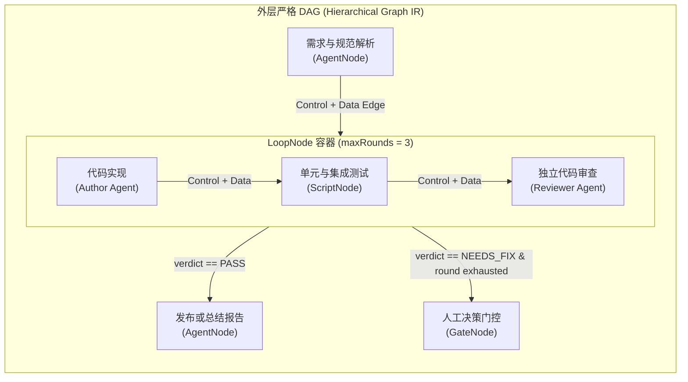
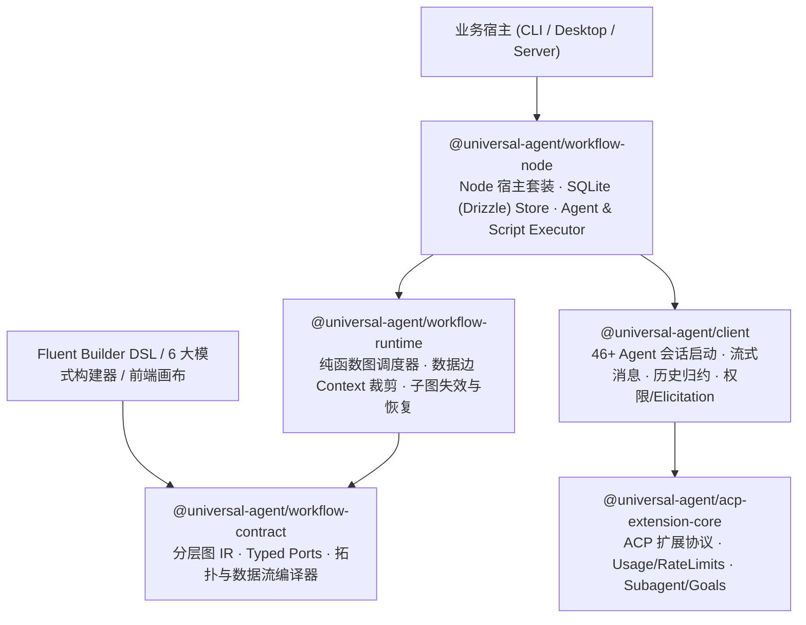

# Universal Agent Workflow Kit 架构与实施计划 (`@universal-agent/workflow-*`)

状态：Ready for Implementation（基于**分层受控图 Hierarchical DAG** 与 `@universal-agent/client` 底座的 Phase 1 / 2 / 3 实施蓝图）  
更新日期：2026-10-23

---

## 1. 目标与核心设计哲学

基于本仓库已完成的底层通用 Agent 客户端（`@universal-agent/client`，支持 9 个内置引擎 + 37+ ACP Registry 引擎、统一进程树生命周期、流式消息与 `SessionHistoryAccumulator` 历史归一化）与扩展协议包（`@universal-agent/acp-extension-core`），构建一套**基于分层受控图（Hierarchical Structured Graph）、可嵌入、零常驻服务依赖、支持长程有界上下文与崩溃恢复**的通用编排套件：**Universal Agent Workflow Kit**。

核心设计哲学：
1. **底层采用“分层受控图 IR（Hierarchical DAG）”，拒绝“任意 Goto 自由图”**：
   - **外层严格 DAG（有向无环图）**：任何同层节点之间禁止直接连回边（Back-edge），从根源上消除死锁、入度歧义与不可判定终止。
   - **控制边（Control Edge）与数据边（Data Edge）分离**：控制边只表达“谁完成后允许激活谁”，数据边显式表达“谁的哪个输入端口消费谁产出的哪个 `ArtifactVersion`”。
   - **循环与并发通过作用域容器（Scoped Containers）表达**：循环修订通过 `LoopNode` 容器包裹内部子图（Sub-DAG），并发扇出通过 `ParallelNode` 容器包裹内部子图。
2. **底层是严谨 Graph IR，上层是 Fluent Builder / Pattern DSL**：
   - 底层存储、静态校验、增量失效、断点恢复和前端画布渲染（如 React Flow）统一消费标准 Graph JSON IR。
   - 开发者编码时无需手写冗长的节点/边数组，直接调用链式 `WorkflowBuilder` 或 6 种高阶 Pattern Builder 自动编译为底层标准图结构。
3. **底层 Agent 能力直接复用 `@universal-agent/client`**：
   - 会话启动/恢复/Fork、进程树清理、流式历史归约与权限回调全部由 `@universal-agent/client` 承担，Workflow 层专注图调度与上下文/证据协议。

---

## 2. 为什么采用“分层受控图（Hierarchical DAG）”？（五大核心收益）

在运行时内核中引入上述受控图结构，直接解决多 Agent 编排中的 5 个核心工程难题：

1. **自动并发识别与写范围（Write Scope）冲突调度**
   - 调度器根据控制边拓扑入度自动计算当前 `Ready Set`（所有前驱均已满足的节点集合）。
   - 结合节点声明的 `writeScopes`（文件/目录写入范围），同一轮 `Ready Set` 中写范围不重叠的节点自动并发执行，重叠节点自动按读写租约排队串行化，无需用户手写锁或 `Promise.all`。
2. **数据边驱动的 Context Bundle 自动裁剪（防上下文污染）**
   - 节点启动准备（`prepare`）时，Runtime 仅沿着指向该节点的**入向数据边（Incoming Data Edges）**精确拉取直接依赖的 `ArtifactVersion` 与结构化字段构造 `ContextManifest`。
   - 中间经过但无数据边相连的节点对话与工具噪音被天然隔离，同时跨越多跳的前置关键产物（如原始验收标准）可通过一条显式数据边直达下游 Reviewer。
3. **可达子图（Reachable Subgraph）驱动的精准失效与局部重跑**
   - 当某个节点因人工修改输入、局部重跑或从历史节点 **Fork** 产生新版产物时，Runtime 沿着该节点的**出向数据边可达子图**精确标记受影响的下游 `Assessment (PASS)` 为 `STALE`，只重跑受影响子图，不相关的平行分支完全复用已有结果。
4. **可序列化图状态机：天然支持崩溃恢复（Resume）与时间旅行（Fork）**
   - 图拓扑（不可变）与运行状态叠加层（每个节点/边/容器轮次的激活状态）完全可序列化为 JSON/SQLite 记录。
   - 遇到 `GateNode` 或 `WaitRequest` 等待数小时甚至进程退出后，无需保留内存调用栈，重启后根据图状态快照即可精确恢复调度。
5. **运行前静态体检与可视化画布零成本对接**
   - 在真正调用大模型花 Token 之前，`@universal-agent/workflow-contract` 即可通过图算法完成静态体检：环路检测、孤立/不可达节点检测、端口 Schema 类型匹配校验、Reviewer 节点是否漏接原始标准端口检查。

---

## 3. Monorepo 三包架构规划

在 `packages/` 下新增三个公共包（与现有的 `@universal-agent/acp-extension-core`、`@universal-agent/client` 共用 Rolldown 构建与 GitHub Actions OIDC 自动发布流水线）：

| 包名 | 目录 | 职责边界 | 依赖约束 |
| :--- | :--- | :--- | :--- |
| **`@universal-agent/workflow-contract`** | `packages/workflow-contract` | 分层受控图 Schema（Nodes / ControlEdges / DataEdges / Scoped Containers）、Typed Ports、DAG 拓扑编译器、可达子图分析器、确定性 SHA-256 `definitionDigest`、链式 `WorkflowBuilder` 与 6 种标准模式 Builder | 纯 TypeScript + `zod`；**零 Node.js 内置模块依赖**，浏览器与服务端通用 |
| **`@universal-agent/workflow-runtime`** | `packages/workflow-runtime` | 纯函数图状态机归约器（Ready Set / 条件分支裁剪 / Loop 子图轮次 / Parallel 批次扇出汇合 / Gate 挂起）、数据边驱动的 `ContextBundle` 预算控制与分页读取、子图失效传播、`open → prepare → accept → publish` 协议、抽象运行端口 | 仅依赖 `@universal-agent/workflow-contract` 与 `zod`；不绑死具体数据库、文件系统或 CLI |
| **`@universal-agent/workflow-node`** | `packages/workflow-node` | 开箱即用的 Node 运行时适配：基于 `@universal-agent/client` 的 `UniversalAgentExecutor`、基于进程树管理的 `ScriptExecutor`、基于 `node:sqlite` + Drizzle 的 `SqliteRuntimeStore` 与内容寻址 `SqliteArtifactStore`、本地目录/Worktree 读写锁 `LocalWorkspaceManager` | 依赖 `@universal-agent/workflow-runtime` 与 `@universal-agent/client` |
| **`@universal-agent/workflow-agents`** | `packages/workflow-agents` | node 之上的 Agent 层：版本化 `AgentProfile`（名字 / 职责 / 行事准则 / 执行引擎绑定）存入 node 的同一个数据库（独立迁移日志）；LLM 版 Chief（`AgentChiefSupervisor`）；`createAgentWorkflowRuntime` 一键组装。后续的记忆与自我进化也放在这里 | 依赖 `@universal-agent/workflow-node`；node 包本身不依赖它，不用 Agent 时可只用 node |

---

## 4. 核心运行机制设计

### 4.1 分层受控图模型（Hierarchical Graph IR）

1. **五类标准图节点（`WorkflowNode`）**：
   - `AgentNode`：声明角色/引擎特征、输入/输出 Typed Ports、Prompt 模板、`writeScopes` 与上下文预算。
   - `ScriptNode`：声明确定性命令、工作目录、环境变量、超时与验证退出码规则。
   - `GateNode`：结构化人类决策/外部审批门控，声明问题 Schema 与超时策略。
   - `LoopNode`（容器节点）：内嵌一个完整的子 `WorkflowGraph`（`bodyGraph`），声明 `maxRounds`、继续/退出条件谓词（如基于内部 Reviewer 节点的 `AssessmentVerdict`）以及跨轮次保留的端口映射。
   - `ParallelNode`（容器节点）：内嵌一个完整的子 `WorkflowGraph`（`itemGraph`），声明 `items` 输入端口、`maxConcurrency`、失败策略（fail-fast 或 settle-all）以及 Fan-in 汇总输出端口。

2. **两类有向边（`ControlEdge` vs. `DataEdge`）**：
   - `ControlEdge`：`{ id, fromNodeId, toNodeId, when?: EdgeCondition }` —— 控制执行先后顺序与条件分支路由（如 `verdict === 'PASS'` vs `verdict === 'NEEDS_FIX'`）。当某条 `ControlEdge` 条件为假时，沿图向后传播 `SKIPPED` 状态（除非汇合节点还有其他激活的入边）。
   - `DataEdge`：`{ id, fromNodeId, fromPort, toNodeId, toPort, required: boolean, delivery: 'inline' | 'artifact_ref' | 'auto' }` —— 显式声明数据与产物传递路径，直接驱动 `ContextBundle` 组装与增量失效分析。

### 4.2 双层状态模型：图执行状态层 vs. 工作与证据层

1. **图执行状态层（Execution State Overlay）**：
   - `WorkflowRun`：顶层实例，持有 `status`、`revision`（CAS 版本号）、`coordinatorEpoch`（推进者租约栅栏）以及每个节点/容器作用域的状态映射。
   - `NodeExecutionState`：记录每个节点在当前作用域（顶层、某轮 `LoopRound` 或某个 `BatchItem`）下的状态（`PENDING` / `READY` / `RUNNING` / `WAITING` / `SUCCEEDED` / `FAILED` / `SKIPPED` / `STALE`）与最新 `attemptId`。
   - `NodeAttempt`：单次执行尝试（严格区分技术重试 `retryCount` 与 Loop 业务修订 `roundIndex`）。
   - `WaitRequest`：挂起在某个节点 Attempt 上的结构化等待单（关联 `requestId`、问题详情与权限要求）。

2. **工作与证据层（Work & Evidence Model）**：
   - `Invocation`：绑定到具体 `attemptId` 的业务调用记录。
   - `ContextManifest`：依据当前节点的**入向数据边（Incoming Data Edges）**冻结生成的不可变上下文清单（记录每个输入端口绑定的精确 `ArtifactVersion`、内联或引用方式、字节占用与选择原因）。
   - `ArtifactVersion`：内容寻址的不可变产物（SHA-256 摘要、媒体类型、字节大小、产出节点 `attemptId`）。
   - `Assessment`：验证或独立审核结论（`PASS` / `NEEDS_FIX` / `FAIL` / `BLOCKED`），绑定目标 `ArtifactVersion` 摘要与验证证据。

### 4.3 节点内部四阶段协议：`open → prepare → accept → publish`

每个图节点被调度器选中（进入 `Ready Set`）后，在单次执行内部按四阶段推进：
1. **`open`**：分配 `attemptId` 与 `invocationId`，检查入向数据边的上游产物版本是否齐备，向 `WorkspaceManager` 申请 `writeScopes` 读写租约。
2. **`prepare`**：顺着该节点的**入向数据边**收集上游数据与 `ArtifactVersion`，按三类预算规则生成不可变的 `ContextManifest` 并落盘。
3. **`accept`**：调用 `Executor`（如 `@universal-agent/client` 会话或 Script 进程），校验输出端口 Schema，采集新生成的 `ArtifactVersion`、工具/文件证据与 `Assessment`。
4. **`publish`**：在单次 `RuntimeStore.appendMutations` 原子操作中校验 `coordinatorEpoch` 与 `expectedSeq`，以只追加的 `RunMutation` 日志记录状态变化（运行状态 = `foldRunLog(log)`），更新当前节点状态，沿**出向控制边**推进下游节点入度，若产出发生变更则沿**出向数据边可达子图**标记下游旧 `PASS` 为 `STALE`。

### 4.4 长程任务的 Context Bundle 与三类预算控制

| 预算层级 | 默认基准（可按节点/数据边配置） | 核心规则 |
| :--- | :--- | :--- |
| **1. 初始上下文包 (`initialBundleBytes`)** | `32 KiB` | 节点的任务目标、步骤职责、完成标准（Acceptance Criteria）与必填小字段 **100% 原文内联**；超过预算或声明为 `artifact_ref` 的数据边产物自动转为结构化引用卡片（含 SHA-256、摘要、字节数、章节索引），绝不静默截断验收标准。 |
| **2. 按需分页读取 (`pageReadBytes` / `stageReadQuotaBytes`)** | `8 KiB / 页` | 节点仅被允许读取其**入向数据边已授权**的 `ArtifactVersion`（禁止跨分支或偷看未连接节点的中间输出），支持按行/按节/游标分页读取并记录读取回执（Read Receipt）。 |
| **3. 原生会话累积 (`sessionTokenBudget`)** | 依托 `@universal-agent/client` 实时观测 | 图上不同节点默认使用**独立原生 Agent 会话**，靠数据边上的 `ContextManifest` 传递确定性事实；同一节点因触发 `WaitRequest` 问答恢复时，可沿用原 `acpSessionId`（`resumeSessionId`）继续对话。 |

### 4.5 Fluent Graph Builder 与六种内建编排模式

除了支持直接声明或可视化编辑 JSON 图结构外，`@universal-agent/workflow-contract` 提供链式 `WorkflowBuilder` 与 6 种开箱即用的高阶图模式函数（调用后自动生成包含完整节点、控制边、数据边与容器子图的 `WorkflowDefinition`）：

1. **`singleTaskAndReport`（单次执行与报告图）**：`Input → Agent/Script → Output`，无隐式重试环。
2. **`authorAndReviewer`（生产与独立审核图）**：自动构建 `AuthorNode` 与 `ReviewerNode`，并将原始需求/验收标准通过显式 `DataEdge` 同时连给 Author 和 Reviewer，强制独立验证。
3. **`boundedFixLoop`（有界修订循环子图）**：自动生成 `LoopNode` 容器，内含 `Author → Verify (Script) → Review (Agent)` 子 DAG，当验证或审核为 `NEEDS_FIX` 且未超 `maxRounds` 时自动携带失败证据进入下一轮。
4. **`parallelFanOutFanIn`（并行扇出与汇合子图）**：自动生成 `ParallelNode` 容器 + 下游 `ReducerNode`，冻结批次并发执行后通过数据边汇合全部子产物。
5. **`serializedWriterWithReverify`（写冲突串行与受影响子图复验）**：为共享 `writeScopes` 的节点声明写范围并在数据更新后自动沿着数据边子图触发复验。
6. **`humanDecisionGate`（人类结构化决策门控图）**：在关键分支插入 `GateNode`，挂起时释放全部 Agent 进程资源，收到签名响应后沿控制边与数据边恢复下游子图。

---

## 5. 分阶段实施计划（Phase 1 / 2 / 3）

### Phase 1：`@universal-agent/workflow-contract`（分层图 IR、静态图编译器与 Builder DSL）

**目标**：建立零 I/O、零 Node 依赖的分层受控图合同与静态编译器，让任何工作流都能被构建为类型安全的图结构并通过拓扑与数据流静态验证。

#### 1.1 核心模块清单
- `src/schema.ts`：
  - 定义分层图核心 Schema：`WorkflowDefinition`、`WorkflowGraph`、`WorkflowNode`（`agent` / `script` / `gate` / `loop` / `parallel`）、`ControlEdge`、`DataEdge`、`PortDefinition`、`EdgeCondition`。
- `src/dag-compiler.ts`（图算法与静态编译器）：
  - **拓扑排序与环路检测（Kahn / DFS）**：确保每一层 `WorkflowGraph`（顶层图以及每个 `LoopNode`/`ParallelNode` 的内部子图）都是严格无环的 DAG。
  - **控制流与数据流一致性校验**：检查所有 `DataEdge` 的源节点必须在控制流拓扑上先于目标节点（防止读取尚未执行的未来节点数据），检查必填输入端口是否都有对应的入向 `DataEdge` 或默认值。
  - **子图可达性与增量影响分析器（`computeDownstreamSubgraph`）**：给定任意被修改或重跑的节点 ID，利用图遍历算出所有受其控制边或数据边影响的下游节点集合（供 Runtime 做 `STALE` 失效传播与局部重跑）。
  - 输出预编译的 `CompiledWorkflowPlan`（含层次化邻接表、拓扑层级 `topologicalLevels`、每个节点的入向/出向控制边与数据边索引、写范围冲突矩阵）。
- `src/canonical.ts`：
  - 实现跨平台 Canonical JSON 规范化（对节点、边、端口按确定性字典序归一化）与 SHA-256 `definitionDigest` 计算。
- `src/builder.ts` & `src/patterns.ts`：
  - 实现链式 `WorkflowBuilder`（`.addAgent()` / `.addScript()` / `.addLoop()` / `.connectControl()` / `.connectData()` / `.build()`）以及第 4.5 节的 6 种高阶 Pattern Builder。
- `src/events.ts`：
  - 定义公开图运行状态、节点 Attempt 状态、`Assessment` 结论与标准事件流类型。

#### 1.2 Phase 1 放行标准
- [ ] `packages/workflow-contract` 零 Node.js 内置模块依赖，通过构建与类型检查。
- [ ] 单元测试完整覆盖：DAG 拓扑排序、非法回边环路拒绝、数据边逆拓扑序（读未来节点）拒绝、悬空端口拒绝、`computeDownstreamSubgraph` 可达子图计算、Canonical Digest 稳定性、Fluent Builder 与 6 种 Pattern Builder 图编译测试。

---

### Phase 2：`@universal-agent/workflow-runtime`（纯函数图调度器、数据边 Context 裁剪与端口契约）

**目标**：基于 Phase 1 的 `CompiledWorkflowPlan`，实现纯函数图状态归约器、数据边驱动的 `ContextBundle` 构造器与四阶段执行引擎，支持内存模式完整运行与故障注入测试。

#### 2.1 核心模块清单
- `src/ports.ts`：
  - 定义事件溯源的 `RuntimeStore`（`createRun` / `appendMutations` / `readLog` / `acquireCoordinatorEpoch`，含 CAS `expectedSeq` 与 `coordinatorEpoch` 栅栏）与 `RunMutation` / `RunLogEntry`、`Executor`、`ArtifactStore`、`WorkspaceManager`、`Clock`、`IdGenerator` 标准端口。
- `src/scheduler/graph-reducer.ts`（纯函数图调度核心）：
  - 根据 `CompiledWorkflowPlan` 与当前 `WorkflowRun` 状态快照，纯函数计算下一步 `SchedulerDecision`：
    - 计算当前所有入向控制边已满足的 `Ready Set`；
    - 处理条件边分流与未命中分支的 `SKIPPED` 传递（Dead-Path Elimination）；
    - 推进 `LoopNode` 内部子图的轮次重置与退出条件判定；
    - 推进 `ParallelNode` 内部子图的批次克隆、并发限流与 Fan-in 汇合；
    - 根据节点 `writeScopes` 冲突矩阵过滤当前可同时派发的无冲突节点集；
    - 支持 `invalidateAndRerunNode(nodeId)`：调用图编译器的 `computeDownstreamSubgraph` 将受影响下游节点状态与旧 `Assessment` 标记为 `STALE` 并重新归入待调度队列。
- `src/context/bundle-builder.ts`：
  - 仅沿目标节点的**入向数据边（Incoming Data Edges）**提取上游 `ArtifactVersion` 与结构化输出，执行 `initialBundleBytes`（默认 32 KiB）预算控制，生成不可变 `ContextManifest`。
  - 实现受数据边授权约束的 `ArtifactReader`（仅允许分页读取当前节点入向数据边绑定的 Artifact，拒绝越权读取图上其他分支产物）。
- `src/stage/lifecycle.ts` & `src/runtime.ts`：
  - 实现单节点 `open → prepare → accept → publish` 生命周期与 `WorkflowRuntime` 主类（`start` / `step` / `runUntilSettled` / `resume` / `respond` / `rerunFromNode` / `cancel`），内置 `InMemoryRuntimeStore` 与 `InMemoryArtifactStore`。

#### 2.2 Phase 2 放行标准
- [ ] 在固定 `Clock`、`IdGenerator` 与 Mock `Executor` 下，6 种图编排模式的完整状态流转、并行分支汇合、条件跳过（Dead-Path Elimination）与 Loop 修订轮次 100% 确定可重放。
- [ ] 图子图失效测试：重跑上游某节点时，只有沿数据边可达的下游节点被置为 `STALE` 重跑，无关平行分支保持原 `SUCCEEDED` 状态不重跑。
- [ ] 并发栅栏与 Context 预算测试：双协调者 Epoch 冲突拒绝、CAS 失配拒绝、未连数据边的跨节点越权读取拒绝、超大产物自动转引用卡片测试通过。

---

### Phase 3：`@universal-agent/workflow-node`（对接 `@universal-agent/client` 与本地持久化）

**目标**：将图运行时与 `@universal-agent/client`（46+ Agent 引擎）及本地持久化无缝打通，提供生产级多 Agent 协同工作流执行环境。

#### 3.1 核心模块清单
- `src/executors/universal-agent-executor.ts`：
  - 基于 `@universal-agent/client` 的 `startAgentSession` 实现图节点的 `AgentExecutor`。
  - 支持按节点角色绑定不同底层引擎（例如同一张图中：`AuthorNode` 绑定 `claude`，`ReviewerNode` 绑定 `codex` 或 `gemini`）。
  - 将入向数据边生成的 `ContextManifest` 渲染为结构化 Prompt Blocks，通过 `session.getHistory()`（`SessionHistoryAccumulator`）与 `onWriteTextFile` 自动采集输出产物并存入 `ArtifactStore`。
  - 支持同一节点 Attempt 在 `WaitRequest` 问答恢复时通过 `resumeSessionId` 续接原 Agent 会话。
- `src/executors/script-executor.ts`：
  - 复用 `@universal-agent/client` 的跨平台进程树管理（`startProcess` / `terminateChildTree`）执行图上的 `ScriptNode`（如构建、单测、Lint），自动将退出码与日志转化为验证证据。
- `src/store/sqlite/*` & `src/workspace/local-workspace-manager.ts`：
  - 基于 `node:sqlite` + Drizzle（`drizzle-orm/node-sqlite`，迁移由 `drizzle-kit` 生成并随包发布）实现 `SqliteRuntimeStore` 与 `SqliteArtifactStore`。
  - 存储位置：`$UNIVERSAL_AGENT_HOME/workflow/workflow.db`（未设置时为 `~/.universal-agent/workflow/workflow.db`），大于 1 MiB 的产物存为 `workflow/blobs/<sha 前两位>/<sha256>`。
  - 表分三层：合约层（`workflow_definitions` / `definition_nodes` / `definition_edges`，按 `definition_digest` 不可变）；运行日志（`run_log` 为唯一事实来源，`run_snapshots` 加速加载）；查询投影（`runs` / `run_scopes` / `node_states` / `node_attempts` / `context_manifests` / `edge_deliveries` / `assessments` / `wait_requests` / `artifact_read_receipts`），与日志在同一 `BEGIN IMMEDIATE` 事务中更新，多进程共享同一数据库时栅栏依然成立。
  - 产物内容按 SHA-256 去重（`artifacts` 元数据 + `artifact_blobs` 内容）；`edge_deliveries` 记录每条数据边在每次 Attempt 中实际交付的产物版本。
  - 以及基于写范围租约的 `LocalWorkspaceManager`。

#### 3.2 Phase 3 放行标准
- [ ] 跨平台（macOS / Linux / Windows）集成测试通过，验证进程取消、超时清理与临时目录无残留。
- [ ] 提供端到端示例（`examples/workflow-*`）：演示通过 Fluent Builder 构建一张包含 `Author (Agent) → Test (Script) → Reviewer (Agent)` 的 `boundedFixLoop` 分层图，并展示断点恢复与局部重跑能力。

---

## 6. Agent 与 Chief Agent（已实现）

### 6.1 Agent
- **三层拆分**：Node（这次做什么，流程合约）→ Agent（谁来做：`AgentProfile`，按 `id@version` 不可变）→ Runtime adapter（用哪个 client 执行，`runtime.adapter`，默认 `acp`）。
- **只有 AgentNode 绑定 Agent**（`agentRef`）；Loop / Parallel 可设 `defaultAgentRef` 供子节点继承；ScriptNode 与 GateNode 不绑定，保持确定性与人工审批语义。
- **解析顺序**：Chief 的 `swap_agent` 覆盖 → 节点 `agentRef` → 最近容器的 `defaultAgentRef` → 旧的 `role` 绑定。
- **版本固定**：每个 run 首次解析某个 ref 时记录 `agent.pinned`（含 digest），之后同一 run 内一律复用；执行记录与上下文清单都带 Agent 版本，重放可复现。

### 6.2 Chief Agent
- 不在图里，挂在 runtime 上按事件触发：`node.failed`、`loop.round_needs_fix`、`wait.requested`（仅 Agent 提问）、`run.stalled`、`budget.exceeded`、`escalation.resolved`。
- **分级权限**（由低到高）：`observe`（report）< `advise`（inject_guidance）< `escalate`（escalate 给人）< `operate`（retry_node / rerun_from_node / swap_agent / answer_wait / extend_loop）。策略默认 `operate`。
- **永远不能做**：修改验收标准与约束、改判审核结论、替人审批 GateNode、修改 writeScopes 与权限。指令集中根本没有这些操作。
- 每次干预都以 `chief.intervened` 事件写入 run_log（含被拒绝的指令和原因），并投影到 `chief_interventions` 表；有 `maxInterventionsPerRun` 与 `maxLoopRoundExtension` 上限。

