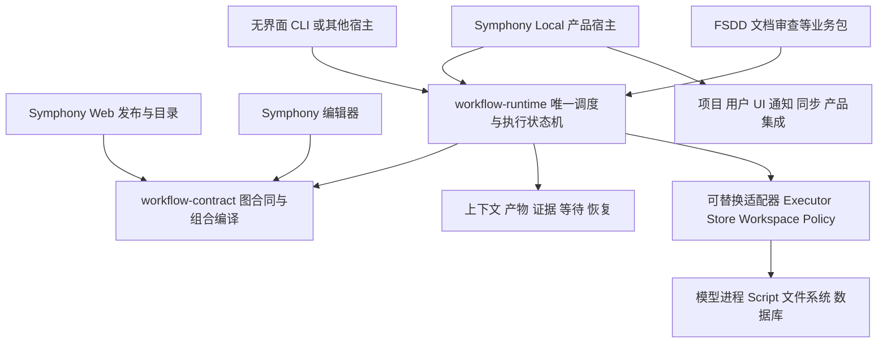

# 通用 Agent Workflow Runtime 提案

状态：Draft，待架构评审。初稿日期：2026-10-21。当前版本为包含 Symphony 内核提取的重评方案。

目标：从 Symphony 与 Wireless 共同提取通用编排内核，再让 Symphony 集成新库。此版替代仅在 Symphony 下面增加 FSDD SDK 的较窄方案。本文已经对照三个项目的本地源码，基线见第 14 节；本轮仅修改提案，不改变运行代码、数据库、已发布流程或当前 Runtime。

## 1 结论与目标

建议建设暂名 **Agent Workflow Runtime** 的共享编排内核，把 Symphony 的通用图合同、调度状态机、执行生命周期、等待恢复，以及 Wireless 的上下文与证据机制一起纳入。**Symphony 改为这个库的产品宿主；FSDD 改为业务工作流包；无界面 CLI 也可以使用同一内核执行流程。**

抽象边界按能力是否通用决定，不按代码目前属于哪个仓库决定。提取以现有实现和行为为基线，不同时保留两个有调度权的引擎。库接管某个 Run 后，Symphony 的旧协调器不再推进这个 Run。

这会同时解决三类具体重复：Web/Local 对 Flow 合同的重复实现、调度与会话/持久化/产品界面的紧耦合、不同业务包各自维护阶段上下文与恢复协议。它也为长程任务提供持久状态和有界上下文，但不能保证模型不犯错或业务成果天然达标。

首版是可嵌入的 TypeScript/Node 库，不要求额外 Node 服务、worker_threads、消息中间件或分布式集群。固定 Workflow 与已声明 items 扩展是起点；分布式执行、运行中任意改图、全部产品 Chat 模式统一和通用流程编辑器 UI 属于后续范围。

## 2 源码核对与可提取依据

| 当前实现 | 已核对的事实 | 提取方向 |
| --- | --- | --- |
| Local `graph-contract.ts`、Web `agent-flow-contract*.ts` | 两边分别解析、校验、规范化和计算图摘要；Web 注释明确其为 Local 的对应实现 | 合并成一个共享合同与编译包，Web/Local/编辑器复用 |
| Local/Web composition 模块 | 精确版本闭包展开、系统输入输出边界、来源映射和组合摘要已经存在 | 提取组合编译器；App/项目权限查询由 resolver 注入 |
| Local `graph-dag-plan.ts`、`graph-dag-state.ts` | 已有 DAG 编译与无 I/O 的状态归约，控制边和数据边职责明确 | 作为通用调度语义的起点，不重新发明另一套图模型 |
| Local `graph-worker-dag.ts`、loops/fanout/inline 模块 | 有持久轮次、冻结批次、重试、等待和中断恢复，但与 `GraphWorkerRuntime`、数据库及产品事件混合 | 拆出调度决策和状态推进，把 I/O 放到明确接口 |
| Local `AgentExecutionService` | 已经封装原生 Agent turn；仍有输入会话绑定、配置和引擎适配依赖 | 提取通用 Executor 契约与可复用生命周期；产品配置和具体 Provider 留在适配器 |
| Local `graph-attempt-transition.ts` | 当前 attempt、pending gate 和 Conversation AgentTurn 在同一 SQLite 事务收尾 | 迁移不能把这一原子边界拆成几个独立成功请求 |
| Local `GraphRunStore` | 目前是对 `SymphonyDb` 的大范围 `Pick`，包含 Graph Chat 和 Task/Workspace 方法 | 需要语义化 Store 接口，不能原样导出为公共 API |
| Local `graphUpstreamPreview.ts`、output references | 已有 16 KiB 上游预览、明确不可信文本提示及精确输出引用 | 上下文选择/分页/预算进入通用模块；Symphony CLI 文案进入宿主适配器 |
| Wireless Scope、stage、commit、publication | 已有因果输入、固定 Call、草稿版本、证据与幂等交接 | 与通用运行模型整合，避免再维护一套阶段执行事实 |
| Wireless `StageNode`/`StageState` | 仍包含视觉、SA、规划恢复和业务 `FlowState` | 提取前隔离领域类型，不能仅改包名 |

本轮比较了 Local 与 Web 中 **23 份同名 Graph/Composition 合同夹具，全部字节一致**。这说明共享合同包有明确迁移基线，不代表两套实现已被证明完全等价；仍需要解析结果、错误码、规范化字节、摘要和真实运行轨迹的差分测试。

## 3 目标架构与公共包



建议目标是独立维护的库仓库，先提供三个公共包，名称待定：

| 包 | 内容 | 依赖约束 |
| --- | --- | --- |
| `workflow-contract` | 版本化定义、ports、JSON Schema 子集、规范化、DAG 校验、组合编译、公开状态/事件类型 | 浏览器与服务端可用；不得导入数据库、文件系统、进程或 Symphony 产品模块 |
| `workflow-runtime` | 调度、attempt、Loop/批次、等待与恢复、Context/Artifact/Assessment、幂等提交与查询投影 | 只依赖 contract 与明确的运行端口；业务条件由插件提供 |
| `workflow-node` | 单机 SQLite/文件实现、Script 进程执行、时间与进程清理等 Node 适配器 | 平台行为显式声明；不绑定 Symphony 数据根、HTTP 路由、账号或 Provider |

Context、Evidence、Session 等先作为 runtime 内部模块，不立即拆成大量 npm 包。原生 Agent 执行适配器可按实际复用需要独立发布；首版可以由 Symphony adapter 调用现有 `AgentExecutionService`，无界面宿主使用 Script/测试 Executor 验证内核确实可独立运行，再接真实 Agent adapter。

共享代码必须只有一个源码所有者。试点可通过 workspace 依赖开发，正式集成使用固定版本制品；Web、Local、编辑器和 Wireless 不再各复制一份合同实现。当前规范化使用 Node crypto 的部分需拆出平台适配，保持规范化字节和 SHA-256 结果一致，不能为浏览器兼容顺便改变已有摘要。

现有 V2 的 `agentId`、reviewer 等资源引用先保留合同含义，由宿主 resolver 转换为冻结的执行者或授权绑定。通用内核只消费绑定，不自行查询 Symphony 项目成员或 Agent 目录。未来需要更通用的 authoring 字段时再显式升级合同，不能把第一阶段提取变成隐式格式重写。

### 3.1 能力最终由谁拥有

| 能力 | 新通用库 | Symphony 产品或业务包 |
| --- | --- | --- |
| 图解析、校验、组合、ready set、分支/Loop/批次 | 库是唯一语义与状态推进实现 | Symphony 调用，不保留另一套可运行调度规则 |
| attempt、重试、超时、取消、等待、恢复、Fork 计划 | 库拥有状态机、预算与身份栅栏 | 宿主提供启动入口、授权、运行资源和用户交互 |
| Session 绑定、完成/暂停/停止结果、事件流 | 库定义统一协议，Executor 执行并回报 | 具体模型/原生 CLI/凭据/运行配置由 adapter 解析 |
| 上下文选择、产物版本、证据依赖、幂等回执 | 库提供通用实现与有界读取 | 业务包定义哪些内容必要、如何检验语义正确性 |
| 工作区范围和写入冲突 | 库统一协调请求与租约语义 | adapter 提供真实目录/worktree、OS 权限和进程控制 |
| Flow 发布合同 | contract 包负责结构与摘要 | Web 保留目录、用户/项目权限、版本发布与分发 |
| UI、Inbox、项目任务、市场、Relay、统计产品页 | 提供可投影的状态/事件 | 保留在 Symphony，不搬进内核 |
| Figma、页面、JSX、视觉分数、Spec、修复策略 | 不进入通用内核 | 保留在 FSDD 业务包 |

当前运行代码仍遵守既有的 Symphony/FSDD 责任边界。上述责任迁移是目标设计，必须通过实现、测试和版本切换完成；不能在提案阶段让 Agent 绕过现有宿主或直接写另一套运行状态。

## 4 长程任务如何控制上下文

### 4.1 把事实、会话与阅读视图区分开

| 数据 | 权威性与保存方式 |
| --- | --- |
| 原始需求、真实回答、获确认决定、正式产物 | 固定来源和版本；保留原文或不可变文件引用 |
| 执行与审核结果 | 绑定具体 Call、输入、源码及验证证据；接受结果不等于质量通过 |
| 对话、工具原始输出、执行日志 | 用于追踪和诊断；不能仅凭一句总结取得业务授权 |
| 摘要、检索索引、阶段导航 | 从权威记录派生，可重建；不能关闭问题、覆盖原文或变成新的事实来源 |

不沿着流程反复“总结上一份总结”。摘要必须能回到确切原始版本，附生成版本与覆盖范围；源版本变化后，旧摘要只作为历史。必要决定和值直接来自结构化记录，不靠模型压缩恢复。

### 4.2 每个节点消费明确的 Context Bundle

拟议 Context Bundle 包含：

1. 当前任务目标、当前步骤职责、完成条件和不允许变化的约束。
2. 已冻结的输入字段、相关决定值、未解决问题的有界索引。
3. 当前允许读取的来源与产物引用，包括版本、摘要、生产节点及用途。
4. 与本次工作有关的变化和失效原因，不注入完整历次讨论。
5. 按需查询入口、剩余预算、遗漏项数量和继续读取方式。

Bundle 本身有不可变 manifest，记录哪些依据被纳入、哪些仅保留引用以及选择原因。输入准备阶段允许修正；Call 开始后绑定 manifest，不随全局“最新结果”变化。实际消费的额外证据另记读取回执，必须属于已授权的冻结来源集合。

原则是“当前目标和必要约束直接给出，详细依据按需读取”。不能为了满足长度上限悄悄删掉验收标准、权限限制、关键决定或高优先级未解决项。

### 4.3 三类预算分别控制

| 预算 | 首版处理 | 边界 |
| --- | --- | --- |
| 初始上下文 | 对通用 Context 模块构造的输入包设置字节预算，必需字段优先，正文改为引用 | 不能覆盖宿主其他系统提示、原生 Skill 自动加载或隐藏上下文 |
| 按需读取 | 精确版本、按节/范围读取、分页；返回 total/hasMore/cursor 和明确截断标记 | 单次有界之外，还要记录同一阶段累计读取量，避免连续翻页又塞回全量 |
| 原生会话累积 | 观测宿主实际输入 token、上下文压缩与重入次数；在合法业务边界结束阶段 | 同 attempt 的问答恢复可能继续原会话，不能把“新上下文包”当作会话已清空 |

试点可从“初始包 32 KiB、正文读取 8 KiB/页、索引 20 项/页”开始测量。这是拟议实验参数，不是当前实现或固定生产默认值；中文、代码和图片的 token 成本不同，字节预算不能直接等同模型窗口。

超限时先返回索引、查询或分页结果；若必需信息本身过大，使用已声明的 items/子 Flow 分解任务。没有合法分解路径时报告具体不足，不能静默截断，也不让用户补写技术 JSON。

必须诚实区分“读取约定”和“技术强制”：若 Agent 仍可通过原生 shell 直接读取任意大文件，框架只能约束受控注入和查询的部分。要保证整个会话的工具输出上限，Executor 必须提供实际可强制的工具通道与预算能力；外层截断 CLI 输出并不能限制模型内部已经看到的内容。运行声明若要求硬限制而 Executor 不支持，应在 admission 明确拒绝或由用户选择有边界的降级，不能宣称已全部限制。

### 4.4 防止错误上下文传播

- 只沿本次已执行分支、确切 item、round、attempt 的因果链读取；缺失时不回退到另一次运行的 head。
- 外部文档、日志和上游模型文本作为数据，不提升成系统指令。模型推测保留为假设，不能自动变成用户决定。
- 需求、输入、源码或规则变化时，由依赖版本和业务验证器识别受影响结果；旧 PASS 不能直接继承。
- 独立审核接收原始标准、目标产物和真实证据；作者的“已通过”总结不能作为审核结论。
- 跨 Runtime 复用必须有明确来源、权限和兼容性判定，不建立默认可读的全局业务记忆库。

结构与摘要只能降低混用和遗漏的风险，不能证明内容本身正确；语义正确性仍由业务测试、独立审核和必要的人工判断负责。

### 4.5 会话隔离与长步骤续作

新的执行协议应显式描述 session 策略：不同业务 Invocation 默认隔离原生会话，依靠 Context Manifest 交接；同 Invocation 的真实问答恢复可以沿用原会话和固定输入。是否能 fresh/resume、能否控制工具输出预算，由 Executor 能力声明决定，不能用同一个接口名称掩盖差异。

长程任务优先拆成有业务边界的短步骤，完整事实与中间产物持久保存。单个步骤过长时，“安全检查点后更换原生会话”可以作为后续能力，但必须先保存已完成动作、部分产物和续作位置，确认旧执行者停止，再从确切记录恢复；不重新授予写入或修复预算。未完成的外部副作用无法核实时，不允许靠换会话重新执行。

首版不承诺任意原生 CLI 的透明中途换会话，也不靠反复压缩同一段对话实现无限运行。提取阶段先保持旧会话行为；Context/session 策略优化作为单独阶段做质量与恢复对照。

## 5 通用内核与执行协议

### 5.1 两个相互关联的状态模型

**执行模型**包括 Definition、Run、CoordinatorEpoch、NodeAttempt、LoopRound、BatchItem、WaitRequest、SessionBinding、EffectReceipt。它描述下一步能否运行、谁有执行权、如何暂停和恢复。

**工作与证据模型**包括 Invocation、InputDraft、ContextManifest、ScopeRef、ArtifactVersion、Assessment、Finding/Decision 版本、Publication。它描述本次工作究竟消费了什么、产出了什么、哪些结论仍有效。

NodeAttempt 与 Invocation 的关联必须明确。一个 attempt 可以有原生会话中的多个 turn，但不能因此生成多个业务 Call；同一次有效接受与重投仍对应原 Invocation。产品重试、业务修订、Loop 下一轮和新的 Fork 分别创建自己的身份，不混用计数。

通用对象允许引用业务 Schema，不包含页面、Figma、组件比例或特定项目字段。Symphony 的 project/task/user ID 在通用层是经授权的外部关联，不成为执行算法的前提。

### 5.2 调度决策与副作用分开

优先从现有纯编译/归约代码提取，逐步让调度核心根据冻结定义、持久状态与已记录的观察产生状态变更和 effect。时钟、ID 分配、容量、进程和外部响应通过端口输入或持久回执提供，不能在重放中随机改变。

Effect executor 承担真正的 Agent/Script 启动、停止、通知、读取和外部写入。执行意图与身份先持久化；进程开始执行用户代码前，登记可核对的启动/清理凭据。失去确认时先查询执行者状态，不能无条件重新启动可能仍在写源码的任务。

同一个 Run 只允许一个拥有有效 epoch/fence 的协调者推进调度。过期进程的完成回调、重复回答和重复提交必须被拒绝或幂等收敛。等待人时释放模型/进程执行配额；Parallel item 的逻辑占位和必要的源码范围保护按冻结规则保留，不能把“释放进程”误写成提前启动下一个串行 item。恢复后沿已保存的 attempt、轮次和批次继续，不能重置预算。

这不要求首版把全部状态改为完整事件溯源。可以保留快照、CAS 更新、append-only 历史与操作回执；关键是状态变更、必需关联和 outbox 在一个明确的提交边界内完成。

### 5.3 运行端口

| 端口 | 最小职责 | 不能隐藏的行为 |
| --- | --- | --- |
| RuntimeStore | 读取精确版本，原子提交状态/回执/outbox，检查 CAS 和协调者 fence | 不拆成多次无事务的 update；不把 `SymphonyDb` 整体作为公共类型 |
| Executor | start/resume/cancel、事件流、结构化等待、能力声明、进程收尾 | 不自动扩大重试、权限或写范围；完成需真实退出/结果证据 |
| ArtifactStore | 不可变正文、日志与正式产物引用、摘要校验、有界读取 | 不把旧文件或另一 Run 的结果当作最新输出 |
| WorkspaceManager | 解析冻结工作区、读写租约、快照、冲突及 cleanup | 不能因进程号或端口相同就认领进程，不冒充 OS 沙箱 |
| Authorization | 主体、资源与动作授权，回答身份、撤销及凭据范围 | 内核不自授权；结构校验和 hash 都不是访问授权 |
| PackageResolver | 精确执行包和执行者配置、能力与完整性 | 不回退到全局当前版本，不自动安装未知包 |
| Clock/Capacity/Projection | 时间与容量观察、可恢复唤醒、产品状态投影 | 投影不反向决定业务 PASS 或推进调度 |

拟议的宿主集成方式如下，名称和类型不是当前可导入 API：

```ts
const runtime = createWorkflowRuntime({
  store, artifacts, executors, workspaces,
  authorization, packages, clock, capacity, projections,
});

await runtime.start({ definition, frozenBindings, input });
await runtime.resume({ runId, expectedRevision });
await runtime.respond({ requestId, authenticatedAnswer, expectedRevision });
```

Symphony HTTP/CLI、界面和后台运行器调用同一套命令；无界面 CLI 注入自己的适配器调用同一套命令。Agent 只持有当前执行范围的受限客户端能力，不直接获得 Store 或协调者权限。

### 5.4 阶段契约和质量

保留 `open → prepare → accept → publish` 的职责作为库内部/客户端协议：open 允许准备草稿，prepare 固定输入与 Call，accept 验证并接受结果，publish 幂等投递。它们留在一个业务节点内部，不为每一步增设画布节点。

执行状态、业务质量、后续策略仍分别表达。NEEDS_FIX 可以成为有效提交，随后由冻结流程决定修订或交接；执行完成、Loop 耗尽、Schema 正确不能自动得到 PASS。业务插件提供输入 Schema、执行效果范围、上下文规则、结果验证与复用判断，不能接管整个调度器。

产品 API 的模型同意、Reviewer 通过和真实人类授权也不能互相代替。等待/回答协议必须带确切请求、主体、attempt 和权限；Script 没有 Agent 输入会话时不能伪装 Agent 调用 ask。若要增加新的通用等待入口，必须作为明确的合同能力实施。

## 6 固定 Workflow 与可复用模式

以现有 Symphony V2 的节点、控制边和数据边为首个稳定合同，迁入共享 contract 包，提供类型辅助与模式构建函数，不新增平行的表达式语言。每个模式展开为唯一的实际 Flow 定义；运行时调度以该冻结定义为准。

| 模式 | 适用场景 | 约束 |
| --- | --- | --- |
| 单次执行与报告 | unit/e2e、数据检查、文档审查 | 完成一次工作并记录真实状态，不隐式附赠修复 Loop |
| 生产与独立审核 | Spec、报告、代码成果 | 作者和 reviewer 分离，审核绑定确切候选版本 |
| 有界修订与复审 | 用户明确要求自动纠错 | 轮数由通用内核拥有；修复必须有后续复验；耗尽保留问题 |
| 并行读取与汇总 | 多页面截图、分文档审查 | 冻结完整 items，完整汇合，空批次须有真实依据 |
| 单写入者与受影响复验 | 共享文件、跨页修复 | 合并重叠写范围，业务包计算受影响消费者，内核按声明安排复验 |
| 等待真实业务决定 | 缺来源、权限、需求取舍 | 宿主结构化问答；原回答身份和版本可追溯，不打印伪等待 |

“首次全量、后续按需”只是一种业务策略。通用内核提供 Scope 和引用机制，不自行判断哪些页面可跳过。技术重试与业务修订分开计数，不能用重试获得额外写入或修复机会。

首版不提供 Agent 之间自由修改共享台账的消息总线。协作依靠 typed outputs、版本化产物与显式汇合；确需中途沟通时，另行声明通道、权限和冻结边界，不能让私下对话更改已经准备的输入。

## 7 持久化归属与一致性

### 7.1 最终目标是一份执行事实

新内核是 Run、attempt、批次、Loop、等待、调用、Scope、验证与 publication 的唯一写入权威。Symphony 的任务状态、对话卡片、统计和通知是产品关联或投影；FSDD 的页面、测试、视觉数据是业务扩展。三者不各维护一套独立的“当前节点/当前轮次/是否完成”。

产品目录和账号仍在 Symphony Web 数据库。执行过程可以继续留在 Local，不要求因为共用库就把 Web PostgreSQL 与 Local SQLite 合并。通用库允许存储适配，但一个 Run 的关键提交必须落在一个具备所需原子性的存储边界里，不能把多个数据库冒充一个本地事务。

### 7.2 先换代码依赖，再考虑物理布局

第一阶段由 SymphonyStoreAdapter 映射现有 Graph 表，继续满足 attempt、pending gate、Conversation AgentTurn 的既有事务语义；Wireless 的证据 store 暂时按原协议提供不可变引用。这是迁移边界，不是两个调度器或两份同义状态双写。跨库仍使用可恢复、幂等交接，不宣称跨库 ACID。

目标阶段为新运行统一通用记录与版本引用，FSDD 专业信息放业务扩展记录或正式产物；旧业务库保留为原版本运行的数据。需要迁移哪些元数据、是否新增表，另做 schema 设计和故障注入验收，不在提取代码时顺手搬全部历史。

无界面宿主的默认 Node Store 可以采用一 Run 一 SQLite、WAL、外键、短同步事务、不可变大正文和文件日志。Symphony 不必在第一步跟着改数据库布局；其 adapter 必须满足相同语义测试。共享文件写入仍按实际工作区协调，分库不能消除同文件冲突。

核心事务包含接受结果、版本栅栏和 publication/outbox；文件先持久化再绑定引用。产品通知在提交后发送，失败重试同一事件。若未来改为异步产品投影，运行真相仍从内核读取，旧投影不得回写或覆盖较新执行状态；不能无说明地降低当前 UI/状态一致性。

外部部署、发布、写 API 等由插件提供幂等操作 ID、查询和不确定结果处理，不能承诺任意副作用恰好执行一次。源代码执行、浏览器、网络或模型调用都不能进入可重算的事务准备回调。

## 8 版本 恢复与切换

- 发布和 admission 冻结 `definitionDigest`、合同版本、内核语义版本、执行包及执行者身份。图身份、引擎身份和业务兼容性分别检查。
- 不必永久兼容旧内部 API；新库可以重构类型、Store 和调用入口。但旧 Runtime、已发布定义、已接受证据不能被原地改写以适配新代码。
- 运行选择内核时固定 `engineBinding`，其具体字段待合同评审。迁移期间，旧运行由旧路径处理、新运行由新路径处理；同一个 Run 绝不同时启用两套协调器。
- 正常 Resume 保留已有冻结身份。旧 Run 要换内核，需显式迁移或新建/Fork，验证目标是否支持精确检查点、分支、批次、轮次、等待和业务证据；没有证明时从更早合法边界重新执行。
- 兼容提取阶段要求现有 V2 定义规范化字节、错误码和摘要不变。需要新语义时显式升级合同/引擎版本，不能悄悄借重构改变含义。
- 长程任务的库升级、模型适配升级、输入变化是不同事件。同一次人类答复恢复不自动允许修改已 prepare 的 Call；新的输入重绑定能力仍需要显式协议。
- 进程清理、取消、租约释放和终态提交保持顺序。不能在旧执行者尚未确认停止时启动同范围的新 writer。
- 跨机恢复还需要检查点与对象运输、完整性、权限和执行环境兼容；本地数据库引用不自动变为可迁移制品。

产品回退通过新 Run 路由回已验证版本，保留失败新 Run 的历史。已经被新内核执行到中途的 Run 不能只改一个开关交回旧引擎，否则会混淆 effect、attempt 和恢复预算。

## 9 三个项目的改造范围

| 来源 | 进入通用库的部分 | 留在原项目或适配器的部分 |
| --- | --- | --- |
| Symphony Local `graph-contract*`、`graph-dag-plan`、composition | 纯合同、校验、规范化字节、组合编译与来源模型 | Node/browser hash 实现、远端版本解析和项目授权 |
| Local `graph-dag-state`、worker-dag、loops、fanout、inline、continuation | ready set、合法转换、轮次/批次与恢复选择规则 | 实际资源获取、进程、DB 调用和产品事件 |
| Local `graph-attempt-transition`、Graph input/request 状态 | attempt/wait 约束、幂等与原子提交要求 | 现有 SQL adapter、Conversation/Task 关联投影 |
| Local `AgentExecutionService`、Script 执行 | Executor 协议、通用生命周期和可复用进程适配 | 原生引擎差异、Provider、凭据、具体 sandbox 与环境装配 |
| Local output references、upstream preview | 精确引用、有界读取、上下文选择与读取证据 | HTTP/CLI 路由、UI 展示、Symphony 专有提示词 |
| Symphony Web `agent-flow-contract*`、dag-plan、composition | 改为依赖共享 contract 包，删除重复实现的维护责任 | 草稿/发布版本、项目成员、资源目录、Web 权限和分发 |
| Symphony 编辑器 | 使用共享合同类型和校验入口 | 画布、布局、表单、产品交互与权限显示 |
| Wireless stage-bindings、handoff、process commit/outbox | 固定调用、因果来源、Context、Artifact、Assessment、幂等交接 | FSDD 页面、Spec、测试/视觉/组件 gates 与专业 Skills |
| Wireless `WorkflowRuntime` | 新运行的通用编排统一接入新内核 | FSDD 独立模式的业务计划与策略；不能再复制一份 scheduler |

提取时不能把 `GraphRunStore = Pick<SymphonyDb, ...>` 或完整 `GraphWorkerRuntime` 作为公共依赖，也不能把 `StageState = FlowState & ...` 原样搬进内核。应按执行事实、状态转换、资源操作和产品投影拆接口。

首版不把所有 Symphony 产品面一起重写。Flow 先接入；Chat/Goal/Butler 等若共用底层 Agent turn 执行器，需要验证其原行为并保留适配层。通用 UI 组件和完整 Provider 管理平台可以后续独立评估，不是内核运行的前提。

## 10 实施顺序

| 阶段 | 具体产出 | 放行条件 |
| --- | --- | --- |
| P0 语义基线 | 三仓源码基线、合同夹具、调度/等待/恢复轨迹、存储事务边界和性能样例 | 所有待迁移能力有来源、归属和不可降低的断言 |
| P1 共享合同 | 独立 contract 包；Web、Local 和编辑器接入同一实现 | 23 份现有配对夹具及相关 parser/composition 测试通过；规范化/摘要/错误码等价 |
| P2 最小可运行内核 | 纯状态机、Store/Executor 端口；无界面 Input→Script→Result 可恢复执行；Symphony 调用同一内核跑受控试点 | Run 只有一个推进者；崩溃、取消、重投不重复执行业务；无产品 DB 类型泄露 |
| P3 执行能力迁入 | Agent、问答、Loop、Parallel、Inline、工作区和恢复适配逐项接入 | 每种能力有新旧轨迹对照；未支持能力在 admission 拒绝，不进入残缺执行 |
| P4 上下文与业务接入 | 合并精确引用/Context/证据层；FSDD 窄链路与独立文档审查包 | 第二个业务包和 headless 宿主不依赖 Symphony/FSDD 内部模块；必要上下文不遗漏 |
| P5 默认切换 | 完整 FSDD 与 Symphony Flow 配对实跑，质量/资源/恢复验收，默认路由切换 | 关键质量非劣、事务/恢复正确、无可重复性能退化，已定义旧运行保留和回退方式 |

选择完整垂直切片，而不是一次搬完所有文件。P2/P3 的迁移选择器在 admission 确定整个 Run 的 engineBinding；禁止运行到一半遇到不支持节点再切回旧协调器。

合同共享、引擎提取、上下文预算优化、FSDD 业务策略变化分别验收。在抽取期间保持当前视觉修复次数、测试策略、提示词关键业务要求和质量门槛，以便判断变化究竟来自哪里。

本次只更新 proposal。后续实施可以涉及三个仓库和一个新共享库，但需要按阶段准备具体可审查改动；不因本文自动创建仓库、安装依赖、迁移数据库、发布或操作真实 Runtime。

## 11 验收与负优化控制

### 11.1 先验证内核语义等价

- 共享 contract 的解析结果、规范化字节、摘要、错误码与现有实现做差分；覆盖条件分支、typed ports、组合、边界、权限字段和超限拒绝。
- 固定时间、ID、容量和 Executor 回执，比较新旧引擎的可执行节点、分支、批次顺序、等待、Loop 轮次和 attempt 变化。非确定性运行用偏序与不变量比较，不把真实并行日志顺序当成唯一正确顺序。
- 对 CAS 失配、两个协调者、旧 epoch 回调、重复结果、重复人类回答、取消与完成竞争、输出投递丢确认做故障注入。
- 覆盖事务中断和进程启动/停止中断，验证 pending wait、attempt、产品关联没有部分终态；确认清理前不释放 writer 权限。
- 精确 Fork、成功兄弟复用、旧轮次结果隔离、预算保留继续有效；不通过降级检查点或扩大重试使测试通过。
- Store/Executor/Workspace 每个 adapter 运行同一套语义合同测试；真实 Windows/Linux/macOS 行为分别验证，模拟测试不能替代实机。

### 11.2 再验证上下文与真实业务质量

现有 1620 项 FSDD 回归和 10 场景／70 次 CLI 模拟是 Wireless 基线；本轮读取的 Symphony 源码和 23 份字节相同夹具不等于完成了 Symphony 测试。迁移还必须执行对应 Graph、App admission、问答、会话和 Web 发布回归，按变更范围逐项记录。

至少选择两个业务包与两个宿主入口：FSDD、非前端文档审查；Symphony、无界面 CLI。用固定数据覆盖短任务、长历史、多 item、共享文件、缺来源、大正文和中断恢复。真实模型样例使用同一需求/设计、模型配置、权限和初始代码进行配对重复运行，保留失败样本。

| 维度 | 观测指标 | 放行原则 |
| --- | --- | --- |
| 内核正确性 | 状态轨迹、CAS/fence、重复副作用、恢复/取消/等待 | 不降低现有拒绝条件，不产生双协调者或跨 attempt 串用 |
| 业务质量 | 相同标准下的视觉/测试通过率、遗漏需求、严重缺陷、人工跟进量 | 不以缩短流程或降低修复次数换取表面性能；关键质量边界先定后测 |
| 上下文正确性 | 必要约束遗漏、错误来源版本、跨权限读取、失效证据沿用 | 确定性样例中零已知遗漏/串用；语义事实由独立审核确认 |
| 上下文规模 | 首包字节、实际输入 token、累计工具输出、会话压缩与重入 | 不相关历史不导致首包无界增长；同时计入后续重复读取成本 |
| 性能 | 冷启动、调度延迟、prepare/accept、总耗时、CPU、峰值 RSS、锁等待 | 串行交替对照，区分短任务/大正文；可重复退化必须排查 |
| 集成成本 | 重复合同代码、宿主 adapter 大小、额外服务与恢复步骤 | 相同语义只有一个实现；无新增常驻服务的默认要求 |

上下文下降比例与耗时改善是实验目标，不是本提案保证。小样本无明显差异不能证明完全等价，真实视觉效果不能由框架单测代替。

## 12 主要风险与设计取舍

| 风险 | 控制办法 |
| --- | --- |
| 把 Symphony 整体打包成库，仍离不开产品数据库 | 纯合同和状态机先提取；Store/Executor/Policy 显式接口；headless 验证 |
| 新旧两套调度器同时推进 | engineBinding 固定到 Run，epoch/fence 防并发；不逐节点临时降级 |
| 合同共享改变历史 hash 或发布语义 | canonical bytes/错误码/夹具差分；确需变化时升级语义版本 |
| 提取破坏原子终态与问答恢复 | 保留现有事务边界，通过 Store adapter 实现；先做故障注入 |
| 产品投影变成新的事实来源 | 内核拥有状态，产品只读投影/提交命令，事件带版本并去重 |
| Context 摘要省略业务条件 | 必需事实固定、摘要有来源、详情按需读、超限不静默截断 |
| 原生 Agent 工具绕过预算 | Executor 声明实际可强制能力；缺能力时不宣称全会话硬限制 |
| 包层次增多导致冷启动和 I/O 退化 | 三个公共包起步，避免逐阶段重复加载/全量读库，测真实 CLI 与端到端路径 |
| 为迁移方便顺带降低业务标准 | 框架迁移与流程策略分别提交、分别验收；保留相同需求的对照 |
| 兼容层永久保留造成双份维护 | 旧运行隔离保留；新运行逐步切换后删除旧实现的新增维护责任，不长期双写 |

保留原来的“只抽 FSDD SDK”作为低成本备选，但它无法消除 Symphony 自身合同重复和调度耦合。把全部代码直接搬到新目录也不能证明通用性。推荐路线是**提取现有引擎、统一语义实现、让 Symphony 接入**，而不是并行再造一个引擎。

## 13 本轮建议确认的决策

1. 目标升级为独立、可嵌入的通用编排运行时，允许提取 Symphony 的合同、调度、等待恢复和通用执行能力。
2. Symphony Web/Local/编辑器接入共享合同；Local 把执行委托给新内核，产品目录、授权、UI、通知和同步保留。
3. Wireless/FSDD 接入相同的上下文、证据与执行协议，专业 Skill 和质量规则留在业务包；独立模式也不另维护同义调度器。
4. 先共享合同，再迁移完整 Run 的执行内核，再优化上下文与业务接入；默认库形态，不引入额外常驻服务。
5. 无界面宿主、第二个业务包、真实质量对照和崩溃恢复是必须验收项，不能只通过修改 import 或节点 JSON 宣称完成。

## 14 源码依据与本次核验范围

本轮只读核对三个工作区，未修改 Symphony Local/Web、运行服务或用户数据库。以下路径相对各自仓库，commit 用于明确本提案的源码依据，不代表已部署版本。

| 仓库与基线 | 关键证据 |
| --- | --- |
| Wireless `ae076314cbf8b131939a6fdc418709b36319a3d0` | stage bindings/sources/handoff/runtime、process commit/outbox、格式 8 存储与业务 gates |
| Symphony Local `b2a001844b5f5e427bfa92d609a18b12bd11f5ac` | `packages/server/src/kernel/graph-contract.ts`、`graph-dag-plan.ts`、`graph-dag-state.ts`、`graph-worker-dag.ts`、`graph-worker-loops.ts`、`graph-attempt-transition.ts`、`graph-worker-types.ts` |
| Symphony Local 同上 | `packages/server/src/execution/agent-execution-service.ts`、`kernel/graph-worker-script-node.ts`、`kernel/graph-workspace-permit.ts`、`prompts/services/graphUpstreamPreview.ts`、`db/methods/graph-agent-input.ts` |
| Symphony Web `defe45253ddc200f0c5a6876700e3e117c9b4f5c` | `src/lib/agent-flow-contract*.ts`、`agent-flow-dag-plan.ts`、`agent-flow-composition*.ts`、`agent-flows-publishing.ts` |
| Local/Web 共享夹具 | `packages/server/test/kernel/fixtures/graph-*.json` 与 `src/lib/__fixtures__/graph-*.json` 中配对的 23 份合同/组合夹具，字节一致；未执行应用测试 |

Wireless 内的详细参考：

- [现有责任边界](../../AGENTS.md)、[当前 Flow](../workflow/fsdd-symphony-flow.md)：迁移前继续遵守的运行约束。
- [Scope 与 attempt](../../packages/fsdd-workflow/src/stages/stage-types.ts)、[因果绑定](../../packages/fsdd-workflow/src/stages/stage-bindings.ts)：精确来源与批次隔离。
- [上下文选择](../../packages/fsdd-workflow/src/stages/stage-sources.ts)、[阶段输入](../../packages/fsdd-workflow/src/flow/flow-node-work.ts)：已有按需机制及尚未全面有界的字段。
- [生命周期](../../packages/fsdd-workflow/src/stages/stage-handoff.ts)、[运行入口](../../packages/fsdd-workflow/src/stages/stage-runtime.ts)：当前宿主/领域耦合点。
- [操作幂等](../../packages/fsdd-workflow/src/process/commit-operation.ts)、[提交上下文](../../packages/fsdd-workflow/src/process/commit-context.ts)、[存储布局](fsdd-storage-layout-redesign.md)。
- [执行包适配](../../packages/fsdd-workflow/src/integrations/symphony/execution-package.ts)、[Scope 投影](../../packages/fsdd-workflow/integrations/symphony/recipe/sqlite-stages.mjs)、[SA 宿主缺口](fsdd-sa-host-contract.md)、[验证记录](../../packages/fsdd-workflow/benchmarks/storage/results/runtime-flow-validation.json)。

Symphony 的 `instructions/runtime-contracts.md`、Web 的 `instructions/agent-flows-and-workspaces.md` 与 bundled Skill 的 Flow/Loop/Parallel/执行包文档共同约束迁移。涉及严格 Relay 合同、新等待能力或冻结执行元数据时，必须同步版本与配对夹具；不能只改 Local，或把本次只读检查当作部署验证。
