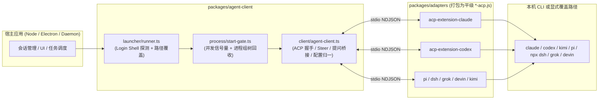

# 基于 Lody 构建独立通用 Agent Client 适配层实施方案 (Plan)

状态：Draft（修订版）。相对初稿补齐：kimi 打包入口、公开命名策略、adapter 去 `@lody/*` 验收、鉴权边界、上游同步、Electron 路径、Phase 5 全量 Agent 与 Windows CI。

## 1. 背景与架构决策确认

本方案旨在基于 Lody 现有的底层 Coding Agent 适配体系（`apps/cli/src/agent` + `packages/acp-extension-*`），抽离并构建一个**独立、通用、零 Lody 业务耦合**的底层 Agent 适配项目，供任意 Node.js / Electron / Daemon 宿主应用直接集成。

已对齐的核心架构决策：

1. **项目交付形态**：**Monorepo（通用 ACP Client 核心 SDK + 内置适配器子包）**
   - 包名与目录对齐：npm 包 `@universal-agent/client` 对应目录 `packages/agent-client`；扩展契约包 `@universal-agent/acp-extension-core`（目录 `packages/acp-extension-core`）；各适配器为 `@universal-agent/acp-extension-*`（目录 `packages/adapters/acp-extension-*`）。
   - 宿主直接 `import` 集成；adapter 入口以平级 `dist/*-acp.js` 随 client 包分发。
2. **首期适配范围**：**7 大内置 Agent 全覆盖 + 通用自定义 ACP 接入**
   - 内置深度适配：`Claude Code`、`Codex`、`Kimi`、`Pi`、`DeepSeek Harness (DSH)`、`Grok`、`Devin`。
   - 通用标准接入：支持通过本地命令或 `npx`/`uvx` 接入任意符合标准 ACP 协议的 Agent（如 OpenCode、Gemini CLI 等）。
3. **运行时管理策略**：**本机优先 + 可选路径覆盖（BYO CLI + Path Override）**
   - 优先探测并使用宿主本机已安装的 Agent CLI（自动合并用户 Login Shell `PATH` 与常见默认安装目录），同时支持宿主通过配置显式传入可执行文件路径覆盖。
   - **彻底剥离** Lody 私有的 R2/CDN 制品镜像下载、`*-runtime-manifest.json` 维护与 `.tar.zst` 解压逻辑，大幅降低包体积与运维负担。
4. **公开命名与 wire 协议策略（兼容但不绑品牌）**
   - **TypeScript 对外导出**使用中性名：`ExtensionCapabilities`、`SubagentEvent`、`parseExtensionNotification` 等；不再导出 `Lody*` 前缀类型（可用 deprecated 别名过渡一个大版本）。
   - **Wire 协议**首期仍识别 `_meta.lody` 与 `_lody/*`（与现有 7 家 adapter 字节兼容）；同时接受等价的 `_meta.ua` / `_ua/*` 别名。新代码写入优先 `_meta.ua`，读取两者皆可。
   - 环境变量：新增中性名（如 `UA_PI_PATH`），同时短暂兼容 `LODY_PI_PATH`；文档与示例只写中性名。
5. **鉴权与凭证边界**
   - SDK **不存储、不下载、不刷新**任何 Agent 账号 token。
   - 宿主负责本机已有登录态或显式传入的 `env`（如各 CLI 官方文档要求的 key）；SDK 只透传 `env` 给子进程。
   - README 维护「各内置 Agent 所需环境变量 / 本机登录方式」表；删除原 `codex-credential-*` 后不引入替代凭证库。
6. **与上游 Lody 的同步策略**
   - `acp-extension-core` 与各 `acp-extension-*`：**拷贝进本仓库并独立版本发布**（不 submodule 绑死 Lody monorepo），在 `UPSTREAM.md` 记录来源 commit。
   - 协议变更走本仓库 semver：`acp-extension-core` 的 breaking change 必须 bump major，并在同一 PR 内升级全部内置 adapter + client。
   - 定期（或按需）从 Lody 反向移植 bugfix；冲突以本仓库的「零 `@lody/*`、BYO CLI」约束为准。

---

## 2. Lody 原有底层适配架构提炼

Lody 将异构的 Coding Agent 统一抽象为 **ACP（Agent Client Protocol，基于 `@agentclientprotocol/sdk` 的 stdio NDJSON JSON-RPC 2.0 协议）**：

- **协议契约层（`packages/acp-extension-core`）**：在标准 ACP 之上，通过 `agentCapabilities._meta.lody` 与 `_lody/*` 扩展方法补齐了标准协议缺失的生产级特性：
  - 运行中插话与确认握手机制（`_lody/session/steer` + `_lody/session/steer_applied`）
  - 子 Agent 生命周期快照与流式输出（`_lody/subagents/{event,list,cancel,output}`）
  - Token 用量、成本统计与账户限流配额（`_lody/session/usage_update` + `_lody/rate_limits/{get,update}`）
  - 建连初始配置下发（`_meta.lody.sessionConfig`）与指定 Turn 分叉（`_meta.lody.forkAtTurn`）
  - 表单提问附加备注（`elicitation.answerNotes`）与持续目标控制（`_lody/session/goal`）
- **Server 端适配器层（`packages/acp-extension-*`）**：将非原生 ACP（或仅支持基础 ACP）的官方 SDK/CLI 包装为完整的 ACP Server 子进程：
  - `acp-extension-claude`：调用 `@anthropic-ai/claude-agent-sdk` 驱动 `CLAUDE_CODE_EXECUTABLE`。
  - `acp-extension-codex`：启动 `CODEX_PATH app-server` 建立内部 JSON-RPC，并通过 `CodexAcpServer` 转换为 ACP。
  - `acp-extension-pi` / `acp-extension-dsh` / `acp-extension-grok` / `acp-extension-devin` / `acp-extension-kimi`：各自封装对应运行时的私有通信协议。
- **Client 端连接与编排层（`apps/cli/src/agent`）**：
  - `AgentClient` 实现 `acp.Client` 接口，处理双向握手、四路会话建立（`new` / `load` / `resume` / `fork`）、文件读写回调、受控终端回调以及将 `AskUserQuestion` Elicitation 统一桥接为权限审批请求。

---

## 3. 新项目 Monorepo 目录结构规划

```text
universal-agent-sdk/
├── pnpm-workspace.yaml
├── tsconfig.base.json
├── package.json
└── packages/
    ├── acp-extension-core/               # [100% 复用] 高阶 ACP 扩展协议类型与校验 (MIT)
    ├── adapters/                         # [直接复用] Server 端适配器子包 (Apache-2.0 / MIT)
    │   ├── acp-extension-claude/
    │   ├── acp-extension-codex/
    │   ├── acp-extension-pi/
    │   ├── acp-extension-dsh/
    │   ├── acp-extension-grok/
    │   ├── acp-extension-devin/
    │   └── acp-extension-kimi/
    └── agent-client/                     # [核心抽离与重构] 面向宿主的通用 Client SDK
        ├── package.json
        ├── scripts/
        │   └── build.mjs                 # esbuild 打包：产出 dist/index.js + 平级 dist/*-acp.js
        └── src/
            ├── index.ts                  # 对外统一导出 API
            ├── types.ts                  # 从 @lody/shared 提取的纯净公共类型与静态能力表
            ├── entries/                  # 适配器平级打包入口（7 家内置全覆盖）
            │   ├── claude-acp-entry.ts
            │   ├── codex-acp-entry.ts
            │   ├── kimi-acp-entry.ts
            │   ├── deepseek-acp-entry.ts
            │   ├── grok-acp-entry.ts
            │   ├── devin-acp-entry.ts
            │   └── pi-acp-entry.ts
            ├── process/                  # 进程与流基础设施
            │   ├── process-tree.ts       # 跨平台进程组启动与树级强杀 (SIGTERM -> SIGKILL)
            │   ├── stream.ts             # 带背压保护的 Node <-> Web Streams 转换
            │   ├── start-gate.ts         # 进程级并发启动信号量（默认 2，宿主可经 StartAgentSessionOptions.concurrency 覆盖）
            │   ├── startup-monitor.ts    # 启动早退监控与 stderr 环形缓冲捕获
            │   ├── login-shell-env.ts    # 登录 Shell PATH 探测与缓存
            │   └── terminal-manager.ts   # ACP 终端生命周期管理
            ├── launcher/                 # 本机优先 + 路径覆盖启动解析层
            │   ├── executable-resolver.ts# 跨平台可执行文件查找 (显式路径 -> Login PATH -> 默认目录)
            │   ├── setting.ts            # 7 大内置 Agent 与 Custom Agent 的启动参数合成
            │   ├── deepseek-runtime.ts   # DeepSeek Harness 隔离 DSH_HOME 与 profile 生成
            │   ├── npx-cache.ts          # 隔离的 npx 缓存与损坏自愈重试策略
            │   └── runner.ts             # 整合 Gate + Spawn + Monitor + AgentClient 的启动器
            └── client/                   # ACP 客户端核心协议层
                ├── agent-client.ts       # 剥离 Lody 业务耦合后的核心 ACP Client
                ├── extension-parser.ts   # _meta.lody 与 _lody/* 消息解析 (原 lody-acp-extension.ts)
                ├── acknowledged-steer.ts # 运行中插话三态状态机 (applied / not-applied / unknown)
                ├── goal-control.ts       # Goal 持续目标控制协议转换
                ├── capability-norm.ts    # 模型、模式、Reasoning Effort 归一化与静态能力兜底
                └── config-applier.ts     # 按 mode -> model -> dependent options 顺序安全应用配置
```



---

## 4. Lody 源码迁移、改造与裁剪对照表

| 新项目模块路径 | 对应 Lody 原文件 | 迁移策略与具体改造点 |
| :--- | :--- | :--- |
| `packages/acp-extension-core` | `packages/acp-extension-core/*` | **迁入后去品牌化**：保留协议与校验逻辑；对外类型改为中性名；wire 同时识别 `_meta.lody`/`_lody/*` 与 `_meta.ua`/`_ua/*`。**禁止**依赖任何 `@lody/*`。 |
| `packages/adapters/*` | `packages/acp-extension-{claude,codex,pi,dsh,grok,devin,kimi}` | **逻辑复用，依赖重写**：拷贝源码进 Workspace 子包（不 submodule）。迁入后跑依赖审计，去掉全部 `@lody/*`；缺的类型/工具上收到 `acp-extension-core` 或 adapter 内聚。Phase 1 验收以「`pnpm why @lody/*` 为空」为准，而不是「文件原样」。 |
| `src/client/agent-client.ts` | `apps/cli/src/agent/agent-client.ts` | **裁剪约 20% 耦合代码**：<br/>1. 移除 `acp-analytics.ts`（`captureAcp*`）、`reportError`、`startTraceSpan`；<br/>2. 移除 `buildBuiltinMcpServers` 中硬编码的 `lody-mcp-server` 与 `getLocalControlSocketPath`，改为调用外部传入的 `resolveMcpServers({ http })`；<br/>3. 移除 `LegacyCodex*`、`claude-task-lifecycle.ts`、`kimi-task-lifecycle.ts` 等旧版过渡兼容分支。 |
| `src/client/extension-parser.ts` | `apps/cli/src/agent/lody-acp-extension.ts` | **轻量裁剪 + 双前缀**：保留 v1 协议解析与 Grok `always-approve`；读取 `_meta.lody`/`_lody/*` 与 `_meta.ua`/`_ua/*`；删掉 `LEGACY_METHODS`（`_acp_ext:*` 等）。对外模块名不用 `lody-` 前缀。 |
| `src/client/acknowledged-steer.ts` | `apps/cli/src/agent/acknowledged-steer.ts` | **直接迁入**。 |
| `src/client/goal-control.ts` | `apps/cli/src/agent/goal-control.ts` | **直接迁入**。 |
| `src/client/capability-norm.ts` | `apps/cli/src/agent/acp-capability-normalization.ts` | **直接迁入**。同时将 `@lody/shared` 中的 `getStaticBuiltinAcpCapabilities` 静态能力表内联到 `src/types.ts`。 |
| `src/client/config-applier.ts` | `apps/cli/src/session/acp-session-config-applier.ts` | **直接迁入**。保持 `mode -> model -> dependent options` 的有序应用逻辑。 |
| `src/launcher/setting.ts` | `apps/cli/src/agent/setting.ts` | **重点重构**：删除 `getManagedAgentRuntimeManager()` 与 `getAcpBinaryManager()`，改为通过 `executable-resolver.ts` 解析本机命令或显式传入的覆盖路径。 |
| `src/launcher/runner.ts` | `apps/cli/src/agent/acp-runner.ts` | **瘦身重构**：移除 `codex-profile-runtime.ts`、`withoutElectronBootstrapCredentials`、`getGhShimSessionBinRoot`；保留 `startLocalAcpAgent`、`shutdownLocalAcpAgent`、`queryLocalAcpRateLimits`。 |
| `src/launcher/deepseek-runtime.ts` | `apps/cli/src/agent/deepseek-harness-runtime.ts` | **轻量改造**：将 `getLodyDataDir()` 替换为由调用方传入的 `dataDir`（默认 `~/.universal-agent/dsh`）。 |
| `src/launcher/npx-cache.ts` | `apps/cli/src/agent/npx-cache.ts` + `acp-npx-startup-policy.ts` | **轻量改造**：将缓存根目录改为可配置的 `dataDir/npm-cache`，保留 `_npx` 损坏检测与自动清理重试。 |
| `src/process/*` | `acp-session-start-gate.ts` / `acp-startup-monitor.ts` / `login-shell-env.ts` / `terminal-manager.ts` / `utils/stream.ts` | **直接迁入**。将 `@lody/shared/node/process` 中的 `startProcessLegacy` 和 `terminateChildTreeLegacy` 一并内聚到 `src/process/process-tree.ts`。 |
| **彻底废弃（不迁入）** | `managed-agent-runtime.ts` / `managed-runtime-update-coordinator.ts` / `acp-binary-manager.ts` / `*-runtime-manifest.json` / `codex-credential-*` / `magpie-runtime.ts` | **全部删除**。不再需要维护云端制品下载、SHA256 校验、zstd/zip 解压及专属凭证库。 |

---

## 5. 七大内置 Agent 的“本机优先 + 路径覆盖”启动决议设计

在 `src/launcher/executable-resolver.ts` 中，设计统一的二进制查找顺序：
1. 若宿主传入了 `executablePath`（如 `~/custom/bin/claude`），展开 `~` 并校验文件存在后直接使用；
2. 否则合并进程 `env.PATH` + **Login Shell 探测出的 `PATH`** + **Agent 常见默认安装目录**（`~/.local/bin`、`~/bin`、`~/.claude/local`、`~/.kimi-code/bin`、`~/.grok/bin`），在合并后的路径列表中查找对应可执行文件（Windows 下结合 `PATHEXT`）。

各内置 Agent 的具体启动合成规则如下：

| Agent 类型 (`agentType`) | 适配器启动命令 | 底层 CLI 解析与环境变量注入 |
| :--- | :--- | :--- |
| **`claude`** | `process.execPath` + `[dist/claude-acp.js, ...extraArgs]` | 查找 `executablePath ?? findExecutable('claude')`，注入 `env.CLAUDE_CODE_EXECUTABLE = resolvedPath`。 |
| **`codex`** | `process.execPath` + `[dist/codex-acp.js, '-c', 'shell_environment_policy.ignore_default_excludes=true', '-c', 'features.goals=true', ...extraArgs]` | 查找 `executablePath ?? findExecutable('codex')`，注入 `env.CODEX_PATH = resolvedPath`。 |
| **`kimi`** | **默认**本机 CLI：`resolvedKimi` + `['acp', ...extraArgs]`；若未找到 `kimi` 且需要内置适配器回退：`process.execPath` + `[dist/kimi-acp.js, 'acp', ...extraArgs]` | 查找 `executablePath ?? findExecutable('kimi')`（含 `~/.kimi-code/bin`），注入 `env.KIMI_CODE_NO_AUTO_UPDATE = '1'`。**`kimi-acp.js` 必须存在于 `dist/`**（与其他 6 个入口一致），即使默认走本机 CLI，回退路径与打包断言也不能缺。 |
| **`pi`** | `process.execPath` + `[dist/pi-acp.js, ...piExtensionArgs, ...extraArgs]` | `acp-extension-pi` 已自带 `@earendil-works/pi-coding-agent`，默认开箱即用；若传入 `executablePath` 或探测到覆盖路径，则设置 `env.UA_PI_PATH = executablePath`（兼容读取旧名 `LODY_PI_PATH`）。 |
| **`deepseek`** | 通过 `deepseek-runtime.ts` 调用本机 `npx` 加载 `@deepseek-ai/dsh-base` 与 `dist/deepseek-acp.js` | 在 `dataDir/dsh/providers/<providerId>` 下生成 Cordis profile（`lody-acp`），Windows 下自动绕过 `cmd.exe` 8191 字符限制直接调用 `npx-cli.js` 并隐藏子进程控制台窗口。 |
| **`grok`** | `process.execPath` + `[dist/grok-acp.js, ...extraArgs]` | 查找 `executablePath ?? findExecutable('grok')`（含 `~/.grok/bin`），注入 `env.GROK_PATH = resolvedPath` 及 `env.GROK_DISABLE_AUTOUPDATER = '1'`。 |
| **`devin`** | `process.execPath` + `[dist/devin-acp.js, ...extraArgs]` | 查找 `executablePath ?? findExecutable('devin')`，注入 `env.DEVIN_PATH = resolvedPath`。 |

---

## 6. 核心 SDK 对外接口契约（Host API 设计）

`packages/agent-client/src/index.ts` 对宿主暴露简洁、完备的 TypeScript 接口：

```typescript
import type * as acp from '@agentclientprotocol/sdk';
import type {
  ExtensionCapabilities, // 中性名；曾用名 LodyExtensionCapabilities（deprecated alias）
  SubagentEvent,
  RateLimit,
  RateLimitsSnapshot,
  SessionUsageUpdate,
} from '@universal-agent/acp-extension-core';

export type BuiltinAgentType =
  | 'claude'
  | 'codex'
  | 'kimi'
  | 'pi'
  | 'deepseek'
  | 'grok'
  | 'devin';

export type AgentLaunchTarget =
  | {
      cliType: 'builtin';
      agentType: BuiltinAgentType;
      /** 可选：覆盖本机默认探测到的 CLI 可执行文件路径 */
      executablePath?: string;
      /** 可选：Pi 扩展路径列表 */
      piExtensions?: string[];
      /** 可选：DeepSeek Provider 隔离标识 */
      providerId?: string;
      extraArgs?: string[];
    }
  | {
      cliType: 'custom';
      agentType: string;
      command: string;
      args?: string[];
    };

export interface StartAgentSessionOptions {
  sessionId?: string;
  target: AgentLaunchTarget;
  workdir: string;
  env?: NodeJS.ProcessEnv;
  /** SDK 本地状态与缓存目录（用于 DSH profile 与隔离的 npx-cache） */
  dataDir?: string;
  /** 同时启动 ACP 子进程的最大并发；默认 2 */
  concurrency?: number;

  /** 会话恢复与分叉控制（三选一或新建） */
  resumeSessionId?: string;
  forkSessionId?: string;
  forkSessionTurnId?: string;

  /** 建连时携带的初始模型与配置项 */
  initialConfig?: {
    modelId?: string;
    modeId?: string;
    configOptionValues?: Record<string, string | boolean>;
  };

  /** 宿主动态注入 MCP Server 列表（在 initialize 握手获知 http 能力后调用） */
  resolveMcpServers?: (capabilities: {
    http: boolean;
  }) => Promise<acp.McpServer[]> | acp.McpServer[];

  /** 核心回调 */
  onUpdateMessage: (notification: acp.SessionNotification) => void;
  onRequestPermission: (
    requestId: string,
    request: acp.RequestPermissionRequest
  ) => Promise<acp.RequestPermissionResponse>;
  onUsageUpdate?: (usage: SessionUsageUpdate, accountingId?: string) => void;
  onContextWindowUsageUpdate?: (usage: { size: number; used: number }) => void;
  onRateLimitUpdate?: (limit: RateLimit) => void;
  onSessionTitleUpdate?: (title: string) => void;
  onAgentWarning?: (warning: { message: string; source?: string }) => void;
  onWriteTextFile?: (evidence: {
    path: string;
    oldText: string | null;
    newText: string;
  }) => void | Promise<void>;

  signal?: AbortSignal;
}

export interface ManagedAgentSession {
  readonly sessionId: string;
  readonly acpSessionId: string;
  readonly client: AgentClient;
  readonly capabilities: ExtensionCapabilities;

  /** 发送普通对话 Turn */
  prompt(
    blocks: acp.ContentBlock[],
    options?: { signal?: AbortSignal }
  ): Promise<acp.PromptResponse | undefined>;

  /** 在当前运行中的 Turn 中途插话（Steer） */
  steer(
    blocks: acp.ContentBlock[],
    options?: { signal?: AbortSignal }
  ): SteerPromptRun;

  /** 按 mode -> model -> dependent options 顺序安全切换会话配置 */
  applyConfig(config: {
    modeId?: string;
    modelId?: string;
    configOptionValues?: Record<string, string | boolean>;
  }): Promise<void>;

  /** 取消当前正在执行的 Turn */
  cancel(): Promise<void>;

  /** 优雅关闭 ACP Session 并强杀底层子进程树 */
  shutdown(options?: { closeSessionTimeoutMs?: number; exitTimeoutMs?: number }): Promise<void>;
}

/** 核心入口函数 */
export declare function startAgentSession(
  options: StartAgentSessionOptions
): Promise<ManagedAgentSession>;

export declare function probeAgentCapabilities(options: {
  target: AgentLaunchTarget;
  workdir: string;
  env?: NodeJS.ProcessEnv;
  signal?: AbortSignal;
}): Promise<AcpCapabilitiesResult>;

export declare function queryAgentRateLimits(options: {
  target: AgentLaunchTarget;
  workdir: string;
  env?: NodeJS.ProcessEnv;
  signal?: AbortSignal;
}): Promise<RateLimitsSnapshot>;

/** 探测本机可发现的内置 Agent（不启动会话）：显式路径 / PATH / 默认目录 */
export declare function listDetectableAgents(options?: {
  env?: NodeJS.ProcessEnv;
  /** 仅检查列出的类型；默认全部 BuiltinAgentType */
  agentTypes?: BuiltinAgentType[];
}): Promise<
  Array<{
    agentType: BuiltinAgentType;
    found: boolean;
    resolvedPath?: string;
    source?: 'executablePath' | 'path' | 'default_dir';
  }>
>;
```

---

## 7. 分阶段实施路线图（Roadmap）

### Phase 1：搭建 Monorepo 与迁入协议/适配器包（去 `@lody/*`）
- **任务**：
  1. 创建独立仓库，配置 `pnpm-workspace.yaml` 与基础 TypeScript 构建配置；写入 `UPSTREAM.md`（来源仓库与 commit）。
  2. 拷入 `packages/acp-extension-core` 与 `packages/adapters/acp-extension-{claude,codex,pi,dsh,grok,devin,kimi}`。
  3. 依赖审计：删除所有 `@lody/*` 引用；缺失符号上收或内聚；公开类型去 `Lody` 前缀。
  4. 编写根级构建脚本 `prepare:adapters`，先编译 `acp-extension-core`，再编译各适配器包。
- **验收标准**：
  - 全仓 `pnpm build` / `pnpm test` 通过；
  - `pnpm -r exec pnpm why @lody/shared`（及任意 `@lody/*`）无命中；
  - core 对 `_meta.lody` 与 `_meta.ua` 的 fixture 解析测试均通过。

### Phase 2：构建进程控制与流传输底座（`packages/agent-client/src/process`）
- **任务**：
  1. 抽离 `@lody/shared/node/process` 的跨平台进程组启动与 `terminateChildTreeLegacy` 到 `process-tree.ts`。
  2. 迁入 `stream.ts`、`start-gate.ts`、`startup-monitor.ts`、`terminal-manager.ts`。
  3. 实现 `login-shell-env.ts`（带 3 秒超时保护的登录 Shell 环境变量探测与内存缓存）。
  4. `start-gate` 支持构造参数 / 会话级 `concurrency` 覆盖（默认 2）。
- **验收标准**：单元测试覆盖进程树强杀、并发门控排队超时、自定义 concurrency、子进程启动崩溃时的 `stderr` 尾部捕获。

### Phase 3：实现“本机优先 + 路径覆盖”启动层与打包脚本（`packages/agent-client/src/launcher`）
- **任务**：
  1. 实现 `executable-resolver.ts`，支持显式路径覆盖、Login Shell `PATH` 与常见默认目录探测；找不到二进制时给出清晰的错误提示（指明缺失的命令名及可通过 `executablePath` 指定）。
  2. 实现 `listDetectableAgents()`，复用同一解析顺序。
  3. 编写 7 大内置 Agent 的启动参数合成逻辑（`setting.ts` + `deepseek-runtime.ts` + `npx-cache.ts`）；Pi 使用 `UA_PI_PATH`（兼容 `LODY_PI_PATH`）。
  4. 迁入 **7 个** `src/entries/*-acp-entry.ts`（含 `kimi-acp-entry.ts`），编写 `scripts/build.mjs`：esbuild 产出平级 `dist/index.js` 与 `dist/{claude,codex,kimi,deepseek,grok,devin,pi}-acp.js`；构建后断言上述文件均在 `dist/` 根目录且不存在被 hoist 到 `chunks/` 的入口。
  5. 文档注明 Electron / asar 场景：adapter 入口须从解包后的真实文件系统路径 resolve（`import.meta.url` → 文件路径），并在示例或烟测中验证 spawn 成功。
- **验收标准**：`pnpm --filter @universal-agent/client build` 后 `dist/` 含全部 7 个 `*-acp.js`；`resolveAgentLaunch` 对 7 种内置 Agent 解析正确；`listDetectableAgents` 单测覆盖 found/not-found。

### Phase 4：裁剪并合入 `AgentClient` 核心协议层（`packages/agent-client/src/client`）
- **任务**：
  1. 从 `@lody/shared` 提取所需的 Zod Schema（如 `parseSessionNotification`、`parseAskUserQuestionElicitationRequest`、`buildAskUserQuestionElicitationResponse`、`getStaticBuiltinAcpCapabilities`）至 `src/types.ts`。
  2. 迁入 `extension-parser.ts`、`acknowledged-steer.ts`、`goal-control.ts`、`capability-norm.ts`、`config-applier.ts`。
  3. 迁入并清洗 `agent-client.ts`，对接 `runner.ts`，封装出顶层的 `startAgentSession`、`probeAgentCapabilities`、`queryAgentRateLimits`。
- **验收标准**：类型检查（`tsc --noEmit`）零错误；`packages/agent-client` 与全部 adapters 的依赖树均无 `@lody/*`；对外 `.d.ts` 无必须出现的 `Lody` 前缀（deprecated alias 除外）。

### Phase 5：单元测试移植、全量 Agent 验证与 CI 矩阵
- **任务**：
  1. 移植 `acp-runner.test.ts`、`agent-client-session-start.test.ts`、`acp-session-config-applier.test.ts`。
  2. 为 **全部 7 个**内置 Agent 提供启动解析 + adapter 入口的自动化测试；本机未安装对应 CLI 时跳过实跑、不得跳过解析/打包断言。
  3. 编写 `examples/cli-demo.ts` / `examples/simple-chat.ts`：对已安装的 Agent 跑完整 Turn、工具调用、AskUserQuestion、Steer；至少在一台机器上实跑 claude 或 codex。
  4. CI 矩阵：`ubuntu-latest` + `windows-latest`（+ 可选 macOS）。Windows job 必须覆盖 DSH 绕过 `cmd.exe`、`windowsHide`、以及 `terminateChildTree`。
  5. 可选烟测：Electron 打包后 spawn `dist/claude-acp.js`（或等价入口）成功。
- **验收标准**：单元测试全绿；有 CLI 的实跑会话能建立、流式输出、优雅关闭且无孤儿进程；Windows CI 必过；7 个 `*-acp.js` 在 CI 构建产物中存在。

---

## 8. 必须遵守的工程不变量（避坑指南）

1. **平级构建产物布局不可破坏**：
   - `setting.ts` 通过 `import.meta.url` 的同级文件名查找 `claude-acp.js`、`codex-acp.js` 等子进程入口。构建脚本必须将这些入口作为独立 entryPoint 输出在 `dist/` 根目录。
2. **适配器子进程严禁向 `stdout` 打印日志**：
   - ACP 使用 `stdout` 传输 NDJSON 消息。所有 `*-acp-entry.ts` 顶部必须保留 `console.log = console.info = console.warn = console.debug = console.error`，确保非协议输出全部流向 `stderr`。
3. **`fs/read_text_file` 必须将 `ENOENT` 映射为 `-32002`**：
   - 当 Agent 请求读取不存在的本地文件时，必须抛出 `acp.RequestError.resourceNotFound(resolvedPath)`，而不能返回空字符串或普通异常，否则 Kimi / Claude 的 Plan 模式会误判计划文件状态。
4. **Loopback `NO_PROXY` 必须置于环境变量最外层**：
   - 合并完 Login Shell 环境变量后，必须强制在 `NO_PROXY` / `no_proxy` 中追加 `127.0.0.1,localhost,::1`，防止用户的终端代理劫持 Agent 与本地 HTTP MCP Server 或本地网关的回环通信。
5. **Windows 下 DeepSeek Harness 必须绕过 `cmd.exe`**：
   - DSH 的依赖包参数列表超过 Windows `cmd.exe` 的 8191 字符上限，在 Windows 平台必须保持解析 `node_modules/npm/bin/npx-cli.js` 并由 `process.execPath` 直接拉起的机制，同时注入 `windowsHide: true` 防止弹出黑框。
6. **Electron / asar 不得假定源码目录布局**：
   - 通过 `import.meta.url` 定位的 `*-acp.js` 必须是磁盘上可 `spawn` 的真实路径；若打包进 asar，需 `asarUnpack` 或等价解包策略，并在启动失败时报出解析后的绝对路径。
7. **SDK 不落盘宿主密钥**：
   - 不得新增凭证文件、钥匙串写入或 refresh token 逻辑；只透传调用方 `env` 与本机 CLI 已有登录态。


---

## 9. 核心工程模板与脚手架代码示例 (Scaffolding Templates)

### 9.1 根目录 `pnpm-workspace.yaml` 配置

```yaml
packages:
  - 'packages/acp-extension-core'
  - 'packages/adapters/*'
  - 'packages/agent-client'
  - 'examples'
```

根目录另备 `UPSTREAM.md`：记录从 Lody 拷贝的路径与 commit；贡献者指南写明协议变更必须 lockstep 升级 core + adapters + client。

### 9.2 `packages/agent-client/scripts/build.mjs` 平级打包配置

此脚本确保主 bundle 和 **7 个**适配器入口被打包为平级的独立 `.js` 文件，避免被打包器内联或移动到 `chunks/`：

```javascript
import { build } from 'esbuild';
import { existsSync, readdirSync } from 'node:fs';
import { resolve } from 'node:path';

const isWatch = process.argv.includes('--watch');

const entryPoints = {
  index: 'src/index.ts',
  'claude-acp': 'src/entries/claude-acp-entry.ts',
  'codex-acp': 'src/entries/codex-acp-entry.ts',
  'kimi-acp': 'src/entries/kimi-acp-entry.ts',
  'deepseek-acp': 'src/entries/deepseek-acp-entry.ts',
  'grok-acp': 'src/entries/grok-acp-entry.ts',
  'devin-acp': 'src/entries/devin-acp-entry.ts',
  'pi-acp': 'src/entries/pi-acp-entry.ts',
};

const result = await build({
  entryPoints,
  outdir: 'dist',
  bundle: true,
  format: 'esm',
  platform: 'node',
  target: 'node22',
  sourcemap: true,
  splitting: false, // 禁用代码切片，保证每个 adapter entry 是独立的平级单文件
  external: [
    // 保持 Node 核心模块与外部大体积原生依赖外部化
    '@agentclientprotocol/sdk',
    'fsevents',
  ],
});

// 构建后断言：验证所有 adapter 必须存在于 dist/ 根目录下
for (const entryKey of Object.keys(entryPoints)) {
  const expectedPath = resolve(`dist/${entryKey}.js`);
  if (!existsSync(expectedPath)) {
    console.error(`Build verification failed: missing expected output ${expectedPath}`);
    process.exit(1);
  }
}
console.log('Build completed successfully with flat adapter entries.');
```

### 9.3 宿主最小调用示例 `examples/simple-chat.ts`

```typescript
import { startAgentSession } from '@universal-agent/client';

async function main() {
  console.log('Starting Claude Code session...');

  const session = await startAgentSession({
    target: {
      cliType: 'builtin',
      agentType: 'claude',
      // 可选显式传入路径，不传则自动探测本机 PATH
      // executablePath: '/usr/local/bin/claude',
    },
    workdir: process.cwd(),
    initialConfig: {
      modelId: 'claude-3-7-sonnet-20250219',
    },
    onUpdateMessage: (notification) => {
      const update = notification.update;
      if (update.sessionUpdate === 'agent_message_chunk') {
        process.stdout.write(update.content.text);
      } else if (update.sessionUpdate === 'tool_call') {
        console.log(`\n[Tool Call] ${update.title} (${update.kind})`);
      }
    },
    onRequestPermission: async (requestId, request) => {
      console.log(`\n[Permission Request] ${request.toolCall.title}`);
      // 示例才自动授权；生产宿主必须显式确认，且勿默认 allow_always
      const allowOnce = request.options.find((opt) => opt.kind === 'allow_once');
      return {
        outcome: allowOnce ? { outcome: 'selected', optionId: allowOnce.optionId } : { outcome: 'cancelled' },
      };
    },
  });

  console.log(`Session connected! ACP SessionId: ${session.acpSessionId}`);

  // 发送一个测试 Prompt
  await session.prompt([
    { type: 'text', text: '请查看当前工作区有哪些文件，并用一句话总结。' },
  ]);

  // 运行完毕，优雅退出
  await session.shutdown();
  console.log('\nSession terminated cleanly.');
}

main().catch(console.error);
```

---

## 10. 修订说明（相对初稿）

| 项 | 初稿问题 | 修订后 |
| :--- | :--- | :--- |
| kimi 打包 | `adapters` 有 kimi，`build.mjs` / `entries` 缺失 | 7 入口全量包含 `kimi-acp` |
| 零耦合 vs `Lody*` 命名 | 对外类型与 `_lody/*` 仍绑品牌 | TS 中性名 + wire 双前缀兼容 |
| adapter「原样保留」 | 可能仍依赖 `@lody/*` | Phase 1 以依赖树清零为验收 |
| 鉴权 | 删凭证库后未定义边界 | SDK 只透传 `env` / 本机登录态 |
| 上游同步 | 拷贝 vs submodule 未定 | 拷贝 + `UPSTREAM.md` + semver lockstep |
| Phase 5 | 只实跑 4 家、无 Windows CI | 7 家解析/打包必测 + Windows CI |
| Electron | 未提 asar/`import.meta.url` | 不变量 #6 + Phase 3/5 烟测 |
| 发现本机 Agent | 仅有 probe | 新增 `listDetectableAgents` |
| 并发门控 | 写死默认 2 | `concurrency` 可覆盖 |

---

## 11. 各内置 Agent 鉴权与运行依赖（宿主职责，SDK 不代管）

| Agent | 典型本机命令 | 宿主需保证的登录/环境（示例，以官方文档为准） | SDK 行为 |
| :--- | :--- | :--- | :--- |
| claude | `claude` | 本机 Claude Code 已登录，或官方支持的 API/env | 注入 `CLAUDE_CODE_EXECUTABLE` |
| codex | `codex` | 本机 Codex 已登录 / 官方 env | 注入 `CODEX_PATH` |
| kimi | `kimi` | Kimi Code 本机登录态 | `KIMI_CODE_NO_AUTO_UPDATE=1`；可回退 `kimi-acp.js` |
| pi | （adapter 自带或覆盖路径） | 按 pi-coding-agent 要求 | `UA_PI_PATH`（兼容 `LODY_PI_PATH`） |
| deepseek | `npx` + DSH 包 | Provider 凭据写入宿主传入的 `dataDir` profile 流程所需 env | 隔离 `dataDir/dsh/...`，不写全局凭证库 |
| grok | `grok` | 本机 grok CLI 登录态 | `GROK_PATH`、`GROK_DISABLE_AUTOUPDATER=1` |
| devin | `devin` | 本机 devin CLI 登录态 | `DEVIN_PATH` |
| custom | 宿主 `command`+`args` | 宿主自行保证 | 原样 spawn |
